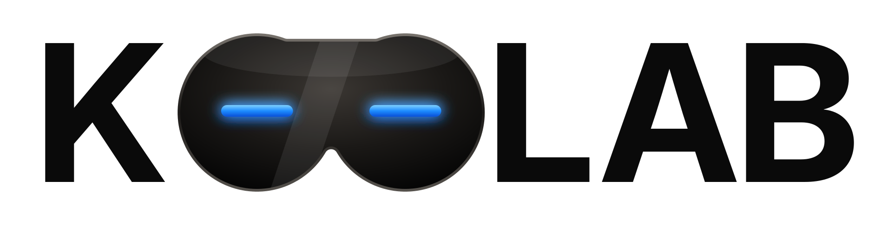
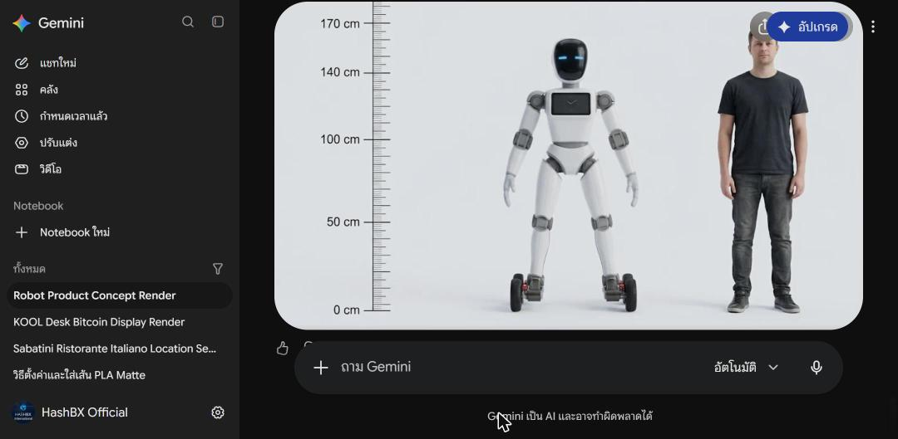
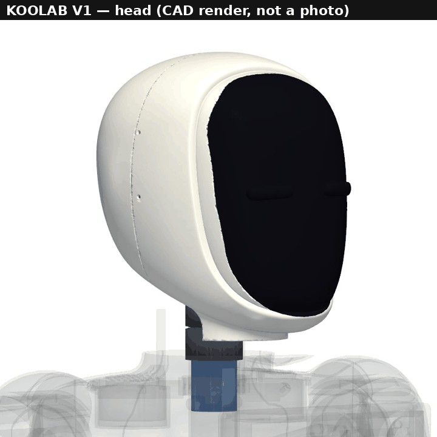

<p align="center"></p>

# Open-source 3D-printed humanoid show robot (K-Bot based) — KOOLAB V1

**[ภาษาไทย → README.th.md](README.th.md)** · [Discussions](../../discussions) · [Good first issues](../../issues?q=is%3Aissue+is%3Aopen+label%3A%22good+first+issue%22) · [Devlog](devlog/) · [Blueprint](docs/blueprint/show-v1.md)

> ⚠️ **Work in progress — be honest with yourself before building.** No complete robot exists yet. What exists today: full V1 CAD (checked for collisions), print files, slicer weights, calculations and draft software. The first parts started printing on a Bambu Lab X2D on 27 Nov 2026. Numbers can still change.

> ™ "KOOLAB", "Kool mini", "KOOL Robot" and the KOOLAB logo are trademarks and are **not** covered by the open licences → [TRADEMARKS.md](TRADEMARKS.md)


*AI-generated concept render — not a photo. The person in the image is also AI-generated.*


*V1 CAD renders. Photos and a GIF of real printed parts go here as soon as the first prints come off the printer.*

## What is it?

A **1.40 m humanoid show robot** for events, booths and showrooms, designed to be **3D-printed at home** and built with simple tools.

- **Talks Thai** — push-to-talk mic array → cloud speech-to-text → LLM → Thai text-to-speech. Listens only while the button is held (privacy by default).
- **Upper body on wheeled feet** — two driven hub wheels per foot (4WD) with spring suspension. V1 does not walk.
- **Full black visor face with light-up eyes** (two 1.9" displays behind a printed PC visor) and a **tilting 8" chest touchscreen**.
- **Hand-posable arms** — friction joints you pose by hand (motorised arms come in V2).
- **Removable 4S1P 72 Wh battery modules** (21700 cells, under 100 Wh each so they can be carried on flights), two per leg.
- **No laser-cutting or lathe shop needed** — hip plate from standard 3"×1/4" aluminium flat bar drilled with a printed jig, tube end plugs printed in PAHT-CF.
- **Everything fits a 256 × 256 × 256 mm bed** — ~160 printed parts, ~9.6 kg of filament (PLA, PETG-CF, PAHT-CF, TPU, PC).
- The walking version (V3) will be rebuilt on the open **K-Bot** design by K-Scale Labs (see [NOTICE](NOTICE)).

## Status

| Version | Goal | Status |
|---|---|---|
| **V1 show robot** | Looks like the concept · talks Thai · 4WD wheeled feet with suspension · hand-posed friction joints · tilting 8" screen | 🟡 CAD done and reviewed · **printing started 27 Nov 2026** · not assembled |
| **V2** | Motorised arms (RobStride-class actuators) on the V1 body | 🔜 planned |
| **V3** | Walking robot rebuilt on the K-Bot design | 🔜 planned |

| Part of V1 | State |
|---|---|
| Stability / tip-over / reach calculations (`sim/`) | ✅ works |
| Wheeled foot V1 (2 wheels per foot, locked rocker, preloaded springs, ToF sensors) | ✅ draft CAD · strength report · not tested |
| 8" chest screen box on an X2D-style barrel hinge (tilts −5…+36°) | ✅ draft STL · not printed yet |
| Full-body blueprint with illustrations | ✅ [docs/blueprint/show-v1.md](docs/blueprint/show-v1.md) |
| Print order (low → high risk) and X2D settings | ✅ [hardware/print-settings.md](hardware/print-settings.md) |
| Clearance test | ✅ printed · fit results pending |
| Hip-plate drill jig | 🖨️ reprinting (1st try failed: jig was upside-down in the slicer — see [devlog](devlog/2026-W48.md)) |
| Voice software on Raspberry Pi 5 · wheel firmware · auto-docking | 🔜 |
| Assembled robot | 🔜 not yet |

Roadmap: [ROADMAP.md](ROADMAP.md) · Spec: [docs/build/show-v1.md](docs/build/show-v1.md) · Weekly devlog: [devlog/](devlog/)

## Order parts kits

**Parts kits: KOOLAB Humanoids** — printed parts and the bought parts for V1 will be available as kits (shop opening soon). Everything needed to build it yourself stays free in this repository.

## Repository layout

| Folder | Contents | Licence |
|---|---|---|
| [`hardware/`](hardware/) | CAD source scripts, generated STEP/STL/DXF, slicer scripts and weights, [print settings](hardware/print-settings.md) | CERN-OHL-S-2.0 |
| [`bom/`](bom/) | Bill of materials (quantities, no shops) | CC BY-SA 4.0 |
| [`docs/`](docs/) | Blueprint, build spec, assembly steps, images | CC BY-SA 4.0 |
| [`software/`](software/) | Show profiles, screen mock-ups (no keys — bring your own `.env`) | Apache-2.0 |
| [`sim/`](sim/) | MuJoCo / numpy calculations | Apache-2.0 |
| [`devlog/`](devlog/) | Weekly log: tried · worked · broke · next | CC BY-SA 4.0 |
| [`brand/logo/`](brand/logo/) | KOOLAB logo files | **All rights reserved** — [TRADEMARKS.md](TRADEMARKS.md) |
| `third_party/` | Unmodified K-Bot files from K-Scale Labs | Their original licences ([NOTICE](NOTICE)) |

## Quick start

```bash
pip install mujoco numpy matplotlib pillow trimesh manifold3d shapely ezdxf
python3 sim/kbot/show_v1_tip.py              # tip-over angles of the V1 show robot
python3 hardware/cad/show_v1/foot_v1.py      # wheeled foot V1 → hardware/cad/out/show_v1_foot1_*
```

Want to print? Start with `hardware/cad/out/` + [print-settings.md](hardware/print-settings.md) (print the clearance test first).

## How to help

You don't need to write code: **test-print parts**, **check the maths**, **suggest replacement parts** you can buy where you live, **translate** (Thai ↔ English), **write Thai or regional show scripts**.

1. Pick a [**good first issue**](../../issues?q=is%3Aissue+is%3Aopen+label%3A%22good+first+issue%22) or [**help wanted**](../../issues?q=is%3Aissue+is%3Aopen+label%3A%22help+wanted%22)
2. Read [CONTRIBUTING.md](CONTRIBUTING.md) (English + Thai · DCO sign-off)
3. Ask, share builds and ideas in [**Discussions**](../../discussions)
4. ⚠️ Read [SAFETY.md](SAFETY.md) before building anything real (36 kg robot, Li-ion batteries, wheels near people)

## Licences

| Part | Licence |
|---|---|
| Hardware design (`hardware/`, including the CAD source scripts and STEP/STL/DXF) | [CERN-OHL-S-2.0](LICENSE-HW) |
| Software and calculations (`software/`, `sim/`) | [Apache-2.0](LICENSE) |
| Documentation and images (`docs/`, `devlog/`, `bom/`, `*.md`, images) | [CC BY-SA 4.0](LICENSES/CC-BY-SA-4.0.txt) |
| `third_party/` | Original licence files in each folder ([NOTICE](NOTICE)) |
| `brand/logo/` | All rights reserved ([TRADEMARKS.md](TRADEMARKS.md)) |

Do not use "K-Bot" or "K-Scale" as the name of a product built from this design.
