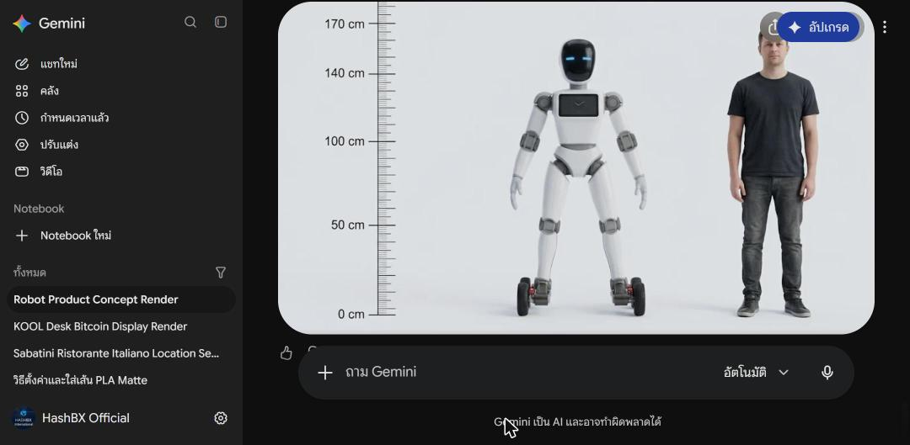
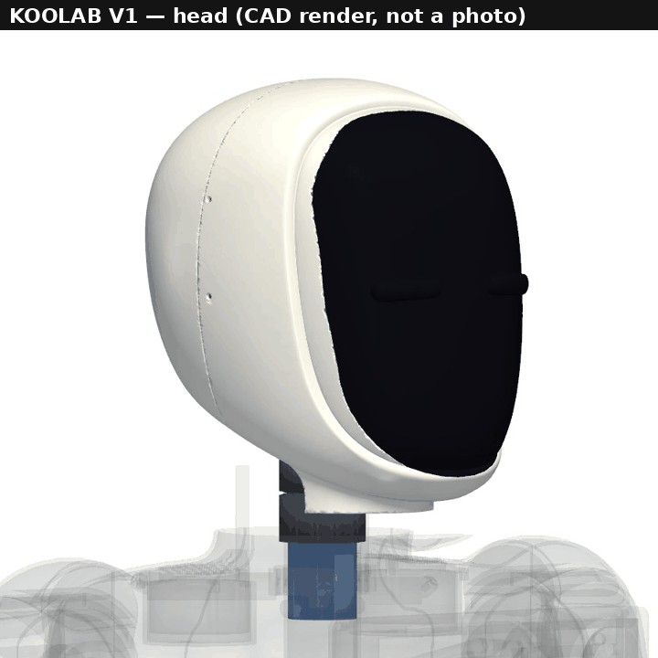

<p align="center"></p>

# หุ่นยนต์ร่างคนพิมพ์ 3 มิติ แบบเปิด (อิง K-Bot) — KOOLAB V1 🇹🇭

**[English → README.md](README.md)** · [Discussions](../../discussions) · [งานเริ่มต้น (good first issue)](../../issues?q=is%3Aissue+is%3Aopen+label%3A%22good+first+issue%22) · [บันทึกรายสัปดาห์](devlog/) · [พิมพ์เขียว](docs/blueprint/show-v1.md)

> ⚠️ **กำลังพัฒนา** — ยังไม่มีหุ่นที่ประกอบเสร็จ · ตอนนี้มี CAD V1 ทั้งตัว (เช็กชนแล้ว) ไฟล์พิมพ์ น้ำหนักเส้นจาก slicer การคำนวณ และซอฟต์แวร์ฉบับร่าง · เริ่มพิมพ์ชิ้นแรกบน Bambu Lab X2D วันที่ 27 พ.ย. 2569 · ตัวเลขยังเปลี่ยนได้

> ™ ชื่อ KOOLAB / Kool mini / KOOL Robot และโลโก้ ไม่อยู่ในสัญญาอนุญาตเปิด → [TRADEMARKS.md](TRADEMARKS.md)


*ภาพแนวคิดจาก AI ไม่ใช่ภาพถ่าย (คนในภาพก็สร้างด้วย AI)*


*ภาพเรนเดอร์ CAD V1 · รูป/GIF ชิ้นพิมพ์จริงจะใส่ตรงนี้ทันทีที่พิมพ์เสร็จ*

## หุ่นนี้คืออะไร

หุ่นยนต์ร่างคนสูง **1.40 ม.** สำหรับงานโชว์ อีเวนต์ บูธ และโชว์รูม **พิมพ์ 3 มิติเองได้** ประกอบด้วยเครื่องมือง่าย ๆ

- **คุยภาษาไทย** — กดปุ่มพูด → ไมค์ 4 ตัว → แปลงเสียงบนคลาวด์ → LLM → เสียงไทย · ฟังเฉพาะตอนกดปุ่ม
- **ท่อนบนร่างคนบนเท้าล้อ** — เท้าละ 2 ล้อขับ (ขับ 4 ล้อ) + ช่วงล่างสปริง · V1 ยังไม่เดิน
- **หน้าดำเต็มหน้า + ตาไฟ** (จอ 1.9" ×2 หลังฝาหน้า PC พิมพ์) · **จอสัมผัส 8" ที่อก ก้ม-เงยได้**
- **แขนจัดท่าด้วยมือ** — ข้อฝืด (แขนมอเตอร์มาใน V2)
- **แบตเป็นโมดูลถอดได้ 4S1P 72 Wh** (เซลล์ 21700 · ก้อนละไม่ถึง 100 Wh ถือขึ้นเครื่องบินได้) ขาละ 2 ก้อน
- **ไม่ต้องพึ่งร้านตัดเลเซอร์/ร้านกลึง** — แผ่นสะโพกจากอะลูมิเนียมแบน 3"×1/4" เจาะตามจิ๊กพิมพ์ · ปลั๊กหัวท่อพิมพ์ PAHT-CF
- **ทุกชิ้นพอดีเตียง 256 × 256 × 256 มม.** — ชิ้นพิมพ์ ~160 ชิ้น · เส้น ~9.6 กก. (PLA, PETG-CF, PAHT-CF, TPU, PC)
- รุ่นเดินได้ (V3) จะทำใหม่ตามแบบเปิด **K-Bot** ของ K-Scale Labs (ดู [NOTICE](NOTICE))

## สถานะ

| รุ่น | เป้าหมาย | สถานะ |
|---|---|---|
| **V1 หุ่นโชว์** | สวยตามภาพต้นแบบ · พูดไทย · เท้าล้อ 4 ล้อ + สปริง · ข้อฝืดจัดท่าด้วยมือ · จอ 8" ก้ม-เงย | 🟡 CAD เสร็จและตรวจทานแล้ว · **เริ่มพิมพ์ 27 พ.ย. 2569** · ยังไม่ประกอบ |
| **V2** | แขนมีมอเตอร์ (ระดับ RobStride) บนตัว V1 | 🔜 |
| **V3** | เดินได้ ทำใหม่ตามแบบ K-Bot | 🔜 |

| ส่วนของ V1 | สถานะ |
|---|---|
| คำนวณมุมล้ม พื้นที่ใช้งาน สัดส่วน (`sim/`) | ✅ ใช้ได้ |
| เท้าล้อ V1 (2 ล้อ/เท้า · คานล็อก · สปริงอัดค้าง · ToF) | ✅ CAD ฉบับร่าง + รายงานความแข็งแรง · ยังไม่ทดสอบจริง |
| กล่องจออก 8" บานพับขอบบน (เงย 0…+60°) | ✅ STL ฉบับร่าง · ยังไม่พิมพ์ |
| พิมพ์เขียวทั้งตัวพร้อมภาพ | ✅ [docs/blueprint/show-v1.md](docs/blueprint/show-v1.md) |
| ลำดับพิมพ์ (เสี่ยงน้อย → มาก) + ค่าตั้ง X2D | ✅ [hardware/print-settings.md](hardware/print-settings.md) |
| ชิ้นทดสอบค่าเผื่อ | ✅ พิมพ์แล้ว · รอผลลองสวม |
| จิ๊กเจาะแผ่นสะโพก | 🖨️ พิมพ์ใหม่ (ครั้งแรกพัง: จิ๊กวางกลับด้านใน slicer — ดู [devlog](devlog/2026-W48.md)) |
| ซอฟต์แวร์เสียงบน Raspberry Pi 5 · เฟิร์มแวร์ล้อ · กลับแท่นชาร์จเอง | 🔜 |
| หุ่นตัวจริง | 🔜 ยังไม่มี |

แผนงาน: [ROADMAP.md](ROADMAP.md) · สเปก: [docs/build/show-v1.md](docs/build/show-v1.md) · บันทึกรายสัปดาห์: [devlog/](devlog/)

## สั่งชุดอุปกรณ์

**สั่งชุดอุปกรณ์ได้ที่ KOOLAB Humanoids** — ชิ้นพิมพ์และอุปกรณ์ที่ต้องซื้อของ V1 จะมีขายเป็นชุด (ร้านเปิดเร็ว ๆ นี้) · ไฟล์ทั้งหมดสำหรับสร้างเองยังเปิดฟรีใน repo นี้

## โครงโฟลเดอร์

| โฟลเดอร์ | มีอะไร | สัญญาอนุญาต |
|---|---|---|
| [`hardware/`](hardware/) | สคริปต์ CAD · STEP/STL/DXF · สคริปต์ slicer + น้ำหนักเส้น · [ค่าตั้งพิมพ์](hardware/print-settings.md) | CERN-OHL-S-2.0 |
| [`bom/`](bom/) | รายการชิ้นส่วนและจำนวน (ไม่มีร้าน) | CC BY-SA 4.0 |
| [`docs/`](docs/) | พิมพ์เขียว สเปก วิธีประกอบ ภาพ | CC BY-SA 4.0 |
| [`software/`](software/) | ไฟล์ตั้งค่างาน ภาพร่างหน้าจอ (ไม่มี key — ใช้ `.env` ของคุณเอง) | Apache-2.0 |
| [`sim/`](sim/) | การคำนวณ MuJoCo / numpy | Apache-2.0 |
| [`devlog/`](devlog/) | บันทึกรายสัปดาห์: ลองอะไร · ผ่าน · พัง · ต่อไป | CC BY-SA 4.0 |
| [`brand/logo/`](brand/logo/) | โลโก้ KOOLAB | **สงวนสิทธิ์** — [TRADEMARKS.md](TRADEMARKS.md) |
| `third_party/` | ไฟล์ K-Bot ต้นฉบับ (ไม่แก้) | ตามสัญญาเดิม ([NOTICE](NOTICE)) |

## เริ่มลอง

```bash
pip install mujoco numpy matplotlib pillow trimesh manifold3d shapely ezdxf
python3 sim/kbot/show_v1_tip.py              # มุมล้มของหุ่นโชว์ V1
python3 hardware/cad/show_v1/foot_v1.py      # เท้าล้อ V1 → hardware/cad/out/show_v1_foot1_*
```

จะพิมพ์: เริ่มที่ `hardware/cad/out/` + [print-settings.md](hardware/print-settings.md) (พิมพ์ชิ้นทดสอบค่าเผื่อก่อน)

## อยากช่วย?

ไม่ต้องเขียนโค้ดเป็นก็ช่วยได้: **พิมพ์ทดสอบ** · **ตรวจตัวเลข** · **แนะนำอะไหล่ทดแทน**ที่หาได้ใกล้คุณ · **แปลเอกสาร** · **เขียนบทพูดไทย/ภาษาถิ่น**

1. ดู issue ป้าย [**good first issue**](../../issues?q=is%3Aissue+is%3Aopen+label%3A%22good+first+issue%22) หรือ [**help wanted**](../../issues?q=is%3Aissue+is%3Aopen+label%3A%22help+wanted%22)
2. อ่าน [CONTRIBUTING.md](CONTRIBUTING.md) (ไทย + English · ต้อง sign-off DCO)
3. ถาม คุย โชว์ผลงานได้ที่ [**Discussions**](../../discussions)
4. ⚠️ อ่าน [SAFETY.md](SAFETY.md) ก่อนสร้างของจริง (หุ่น ~36 กก. · แบต Li-ion · ล้อใกล้คน)

## สัญญาอนุญาต

| ส่วน | สัญญาอนุญาต |
|---|---|
| แบบฮาร์ดแวร์ (`hardware/` รวมสคริปต์ CAD และ STEP/STL/DXF) | [CERN-OHL-S-2.0](LICENSE-HW) |
| ซอฟต์แวร์และการคำนวณ (`software/`, `sim/`) | [Apache-2.0](LICENSE) |
| เอกสารและภาพ (`docs/`, `devlog/`, `bom/`, `*.md`, ภาพ) | [CC BY-SA 4.0](LICENSES/CC-BY-SA-4.0.txt) |
| `third_party/` | ตามไฟล์สัญญาเดิมในแต่ละโฟลเดอร์ ([NOTICE](NOTICE)) |
| `brand/logo/` | สงวนสิทธิ์ ([TRADEMARKS.md](TRADEMARKS.md)) |

ห้ามใช้ชื่อ K-Bot / K-Scale เป็นชื่อสินค้าที่สร้างจากแบบนี้
