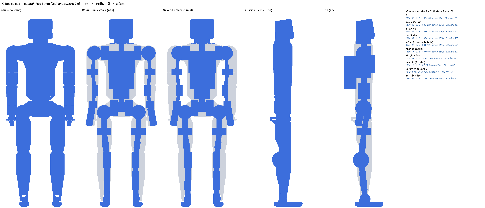
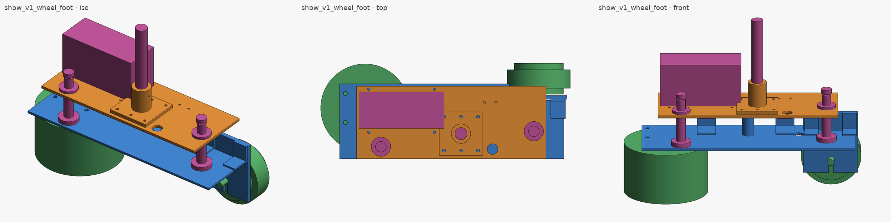
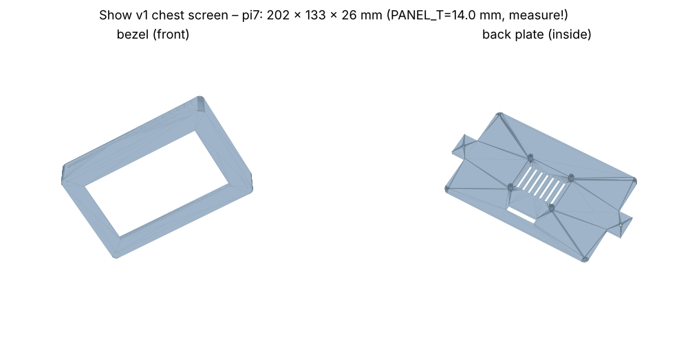

# ประกอบหุ่นโชว์ v1 ทีละขั้น (ฉบับร่าง)

> ⚠️ ยังไม่มีตัวจริง · ขั้นตอนนี้มาจากแบบ CAD และจะปรับเมื่อประกอบจริง · อ่าน [SAFETY.md](../../SAFETY.md) ก่อน
> Draft — derived from CAD; will change once the first robot is built.

ลำดับ: **เตรียมชิ้น → เท้าล้อ → ขา + สะโพก → ลำตัว + จอ → แขน + หัว → เดินสายไฟ → ทดสอบ → ปิดเปลือก**
ประกอบจากล่างขึ้นบน และปิดเปลือกหลังสุด เพื่อให้เข้าถึงสลัก ลูกบิด และสายไฟได้ง่าย

*ซ้าย: สัดส่วน K-Bot เดิม · กลาง/ขวา: แบบผอม มอเตอร์ (หรือมอเตอร์หลอกในรุ่น v1) โผล่ ครอบเฉพาะลิงก์*

## 0) เตรียมชิ้น
1. รันสคริปต์ใน `hardware/` สร้าง DXF/STEP/STL
2. ส่งตัดแผ่นอะลูมิเนียมตาม DXF · กลึงซ็อกเก็ตขาตาม STEP
3. พิมพ์ชิ้นตาม [print-settings.md](../../hardware/print-settings.md) (ทดสอบค่าเผื่อก่อน)
4. **วัดชิ้นซื้อจริง** (ล้อหมุนตาม SHF10 โซลินอยด์ แบต) ให้ตรงกับค่าในสคริปต์ ก่อนส่งตัด

## 1) เท้าล้อ (×2)

1. ขันล้อหมุนตามใต้แผ่นล่าง (M8 ×4) · ยึดแผ่นหางปลาด้วยฉาก 40×40 ×2
2. สวมเพลาล้อขับเข้าร่องหางปลาจากด้านล่าง ขันน็อต M14×1.5 + แหวนกันหมุน
3. ติด SHF10 + เพลานำ ⌀10 · สวมสปริง · ติดยาง PU และฉากรับสลัก
4. ขัน LMF10UU ซ็อกเก็ตขา ฉากโซลินอยด์บนแผ่นบน → วางแผ่นบนลงเพลา → ใส่ปลอกล็อกเพลา
5. วางน้ำหนักเต็มแล้วจึงเจาะรูสลักในฉากรับ ให้ตรงระดับยืนจริง

## 2) ขา + สะโพก
1. เจาะรู M6 ทะลุปลายท่อหน้าแข้งตรงกับซ็อกเก็ต
2. ต่อ หน้าแข้ง → ข้อเข่า → ต้นขา → ข้อสะโพก → แผ่นสะโพก · ตั้งท่ายืนตรงแล้วเสียบสลัก + ปิ๊น R
3. ขันซ็อกเก็ตลงเท้า (M6 ×4 + หมุดนำ ⌀6 ×2) · เช็กขาตั้งตรง
4. ทาสีขีดเส้นเทียบทุกข้อ ไว้ดูว่าคลายหรือยัง

## 3) ลำตัว + จออก

1. ตั้งแกนกลาง ⌀40 บนแผ่นสะโพก · ติดแผ่นไหล่และคอ
2. ประกอบจอ: ฝัง insert M3 ในกรอบ → วางจอ + โฟม 2 มม. → ยึด Pi 5 บนแผ่นหลัง → ปิด → ขันเข้าโครงอก
3. ติดเป้หลัง (คอมพิวเตอร์ เราเตอร์)

## 4) แขน + หัว
1. ข้อไหล่ → ท่อต้นแขน → ศอก → ท่อปลายแขน → ข้อมือ → มือ (ข้อแต่ละข้อ = จาน Hirth + ลูกบิด M8)
2. ติดจอตา + ไมค์หลังหน้ากาก แล้วสวมบนข้อคอ

## 5) เดินสายไฟ
แบต → สวิตช์กุญแจ + ฟิวส์ → (a) ปุ่มหยุด + รีเลย์ → ตัวขับล้อ (b) DC-DC 5V → Pi 5 + ESP32 (c) DC-DC 12V → เราเตอร์ + โซลินอยด์
สายเดินในท่อ ออกที่ปลอกผ่านรูยาง · ปลั๊ก XT60 + GX16 ที่เท้าให้ถอดเปลี่ยนเท้าได้

## 6) ทดสอบก่อนใช้งาน
- [ ] เอียง 15° ทุกทิศ (มีคนจับ) ไม่ล้ม · ดันข้างที่ไหล่ไม่ล้ม
- [ ] ปุ่มหยุดบนหลัง + บนแอป → ล้อหยุดและเบรกล็อก · สัญญาณหาย 0.5 วิ → หยุดเอง
- [ ] ตัดไฟทั้งหมด → สลักล็อกโช้คเสียบ หุ่นยืนอยู่ได้
- [ ] วิ่ง 30 นาที (เลี้ยว หมุนรอบตัว ถอย) · ขับบนแผ่นปุ่ม 10 นาทีแล้วเช็กเส้นสีทุกข้อ
- [ ] กดปุ่มพูด → ตอบไทยไม่เกิน ~3 วิ · เปิดเต็ม 2 ชม. Pi ไม่เกิน 75 °C

## 7) ปิดเปลือก
เปลือกลิงก์จบห่างผิวมอเตอร์ ≥ 25 มม. หรือมีขอบกันนิ้ว · เข่า: เปลือกเริ่มห่างแกนเข่า ≥ 111 มม. เพื่อให้งอได้เต็มองศา
