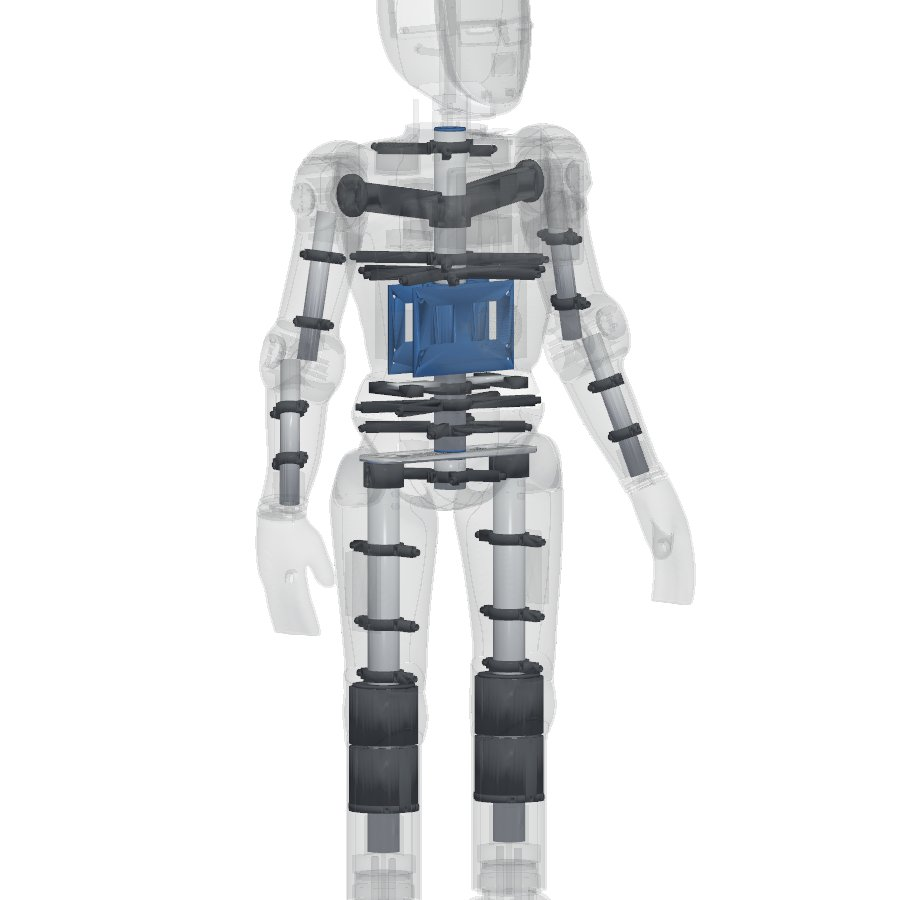
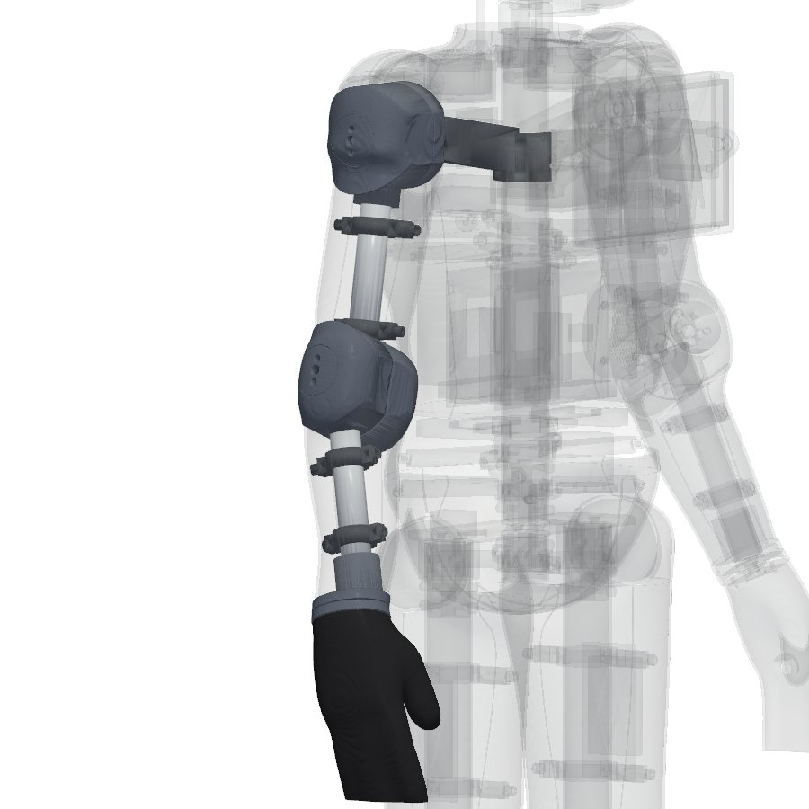
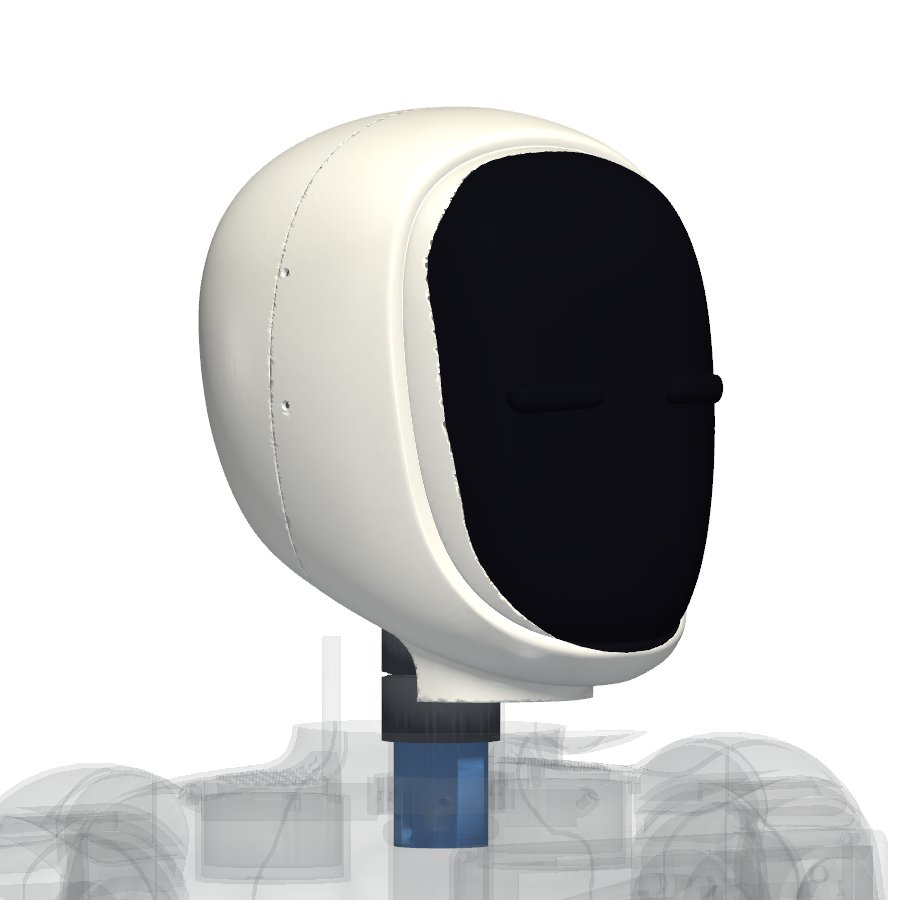
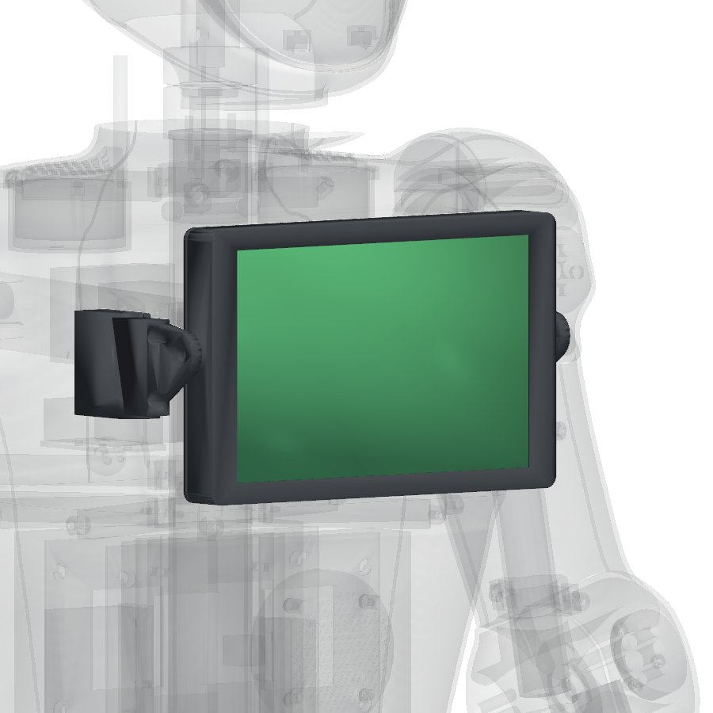
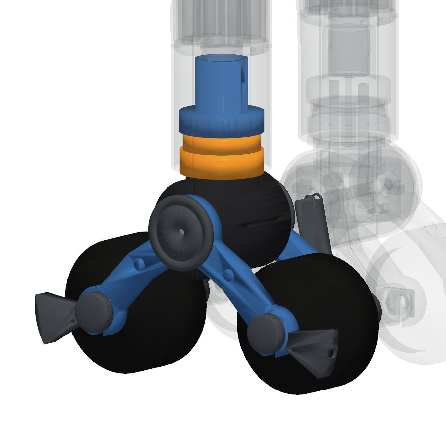
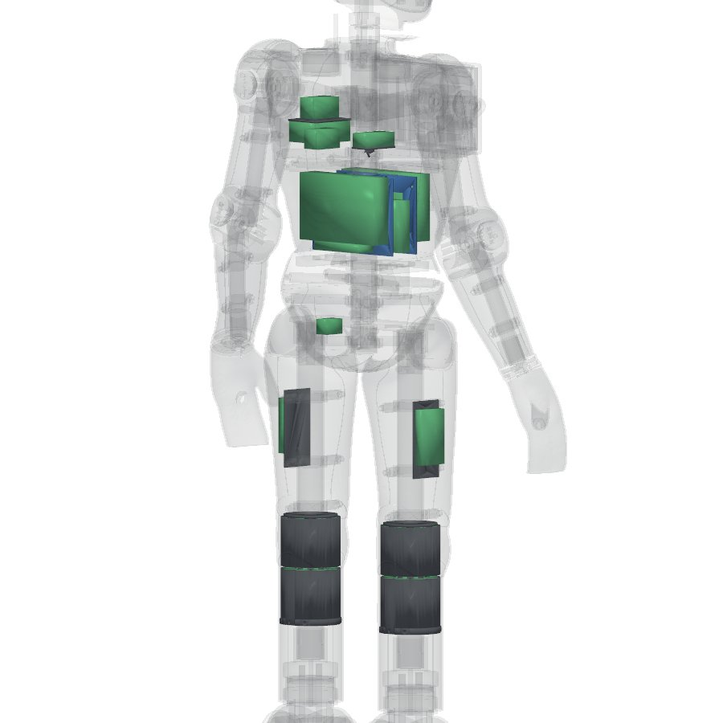
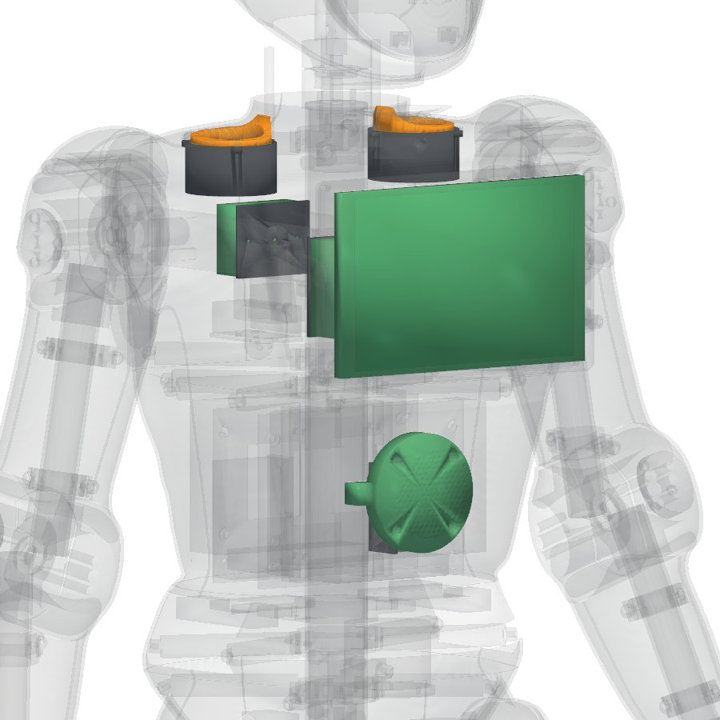
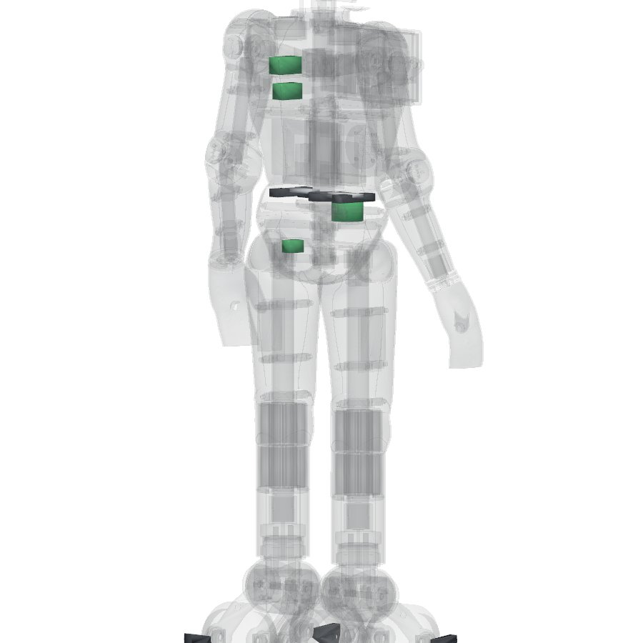

# พิมพ์เขียวหุ่นโชว์ V1 / Show V1 blueprint

> ⚠️ ฉบับร่าง · ยังไม่ได้พิมพ์/ประกอบจริง (ตรวจทานแบบครบ 27 พ.ย. 2569) · ตัวเลขยังเปลี่ยนได้ · อ่าน [SAFETY.md](../../SAFETY.md) ก่อน
>
> สั่งชุดอุปกรณ์ได้ที่ **KOOLAB Humanoids**

หุ่น humanoid สูง 1.40 ม. สำหรับงานโชว์/บูธ: ตัวเปลือกพิมพ์ 3D บนโครงท่ออะลูมิเนียม ขาเป็นท่อตรง เท้าเป็นล้อขับ แขนจัดท่าด้วยมือ (ข้อฝืด) หน้าเป็นจอตา คุยไทยได้ · ทุกชิ้นพิมพ์บนเตียง 256×256×256 มม. ได้ · ชิ้นโลหะทำเองได้ด้วยเลื่อย สว่าน และจิ๊กพิมพ์

*A 1.40 m show humanoid: 3D-printed shell over an aluminium tube frame, straight legs on driven wheel-feet, hand-posed friction-joint arms, eye-display face, Thai voice. Every printed part fits a 256 mm cube bed; metal parts are made with a saw, a drill and printed jigs (no laser cutting or lathe work).*

## 1. ภาพรวม / Overview

| | |
|---|---|
| สูง / น้ำหนัก | 1.40 ม. · ~32–38 กก. (ประมาณ) |
| โครง | ท่อ Al ⌀40×2 (แกนกลาง + ขา) · แผ่นสะโพกจาก Al แบน 3"×1/4" · ปลั๊กหัวท่อพิมพ์ PAHT-CF · ท่อคาร์บอน ⌀25 (แขน) |
| เปลือก | PLA Matte ขาว / PLA ดำ ผนัง 2.4 มม. · ยึดกับปลอกแกน PETG-CF |
| ข้อ | ไหล่ ศอก ข้อมือ คอ = ข้อฝืด M8 + แหวนจาน (จัดท่าด้วยมือ) · ขาไม่มีข้อพับ |
| เท้า | ล้อ hub 4.5" ×2 ต่อเท้า (ขับ 4 ล้อ) · ข้อเท้ายุบ 16 มม. |
| ไฟ | Li-ion 21700 · โมดูลถอดได้ 4S1P 72 Wh ×4 = 8S1P ~290 Wh · เติมเป็น 8S2P ได้ |
| สมอง | Raspberry Pi 5 · ไมค์ ReSpeaker XVF3800 · ลำโพงคู่ · จออก 8" สัมผัส · จอตา 1.9" ×2 |
| ปลอดภัย | E-stop · ตัดไฟล้ออัตโนมัติตอนเสียบชาร์จ · ToF ×4 ที่เท้า · LiDAR 2D ที่เอว (ไม่บังคับ) |

## 2. โครงสร้าง / Frame

- ท่อ Al ⌀40×2 (6061 หรือ 6063 ก็ได้ · ขนาดต้องตรง ⌀40×2 เพราะปลอกพิมพ์ทุกตัวอิงขนาดนี้): แกนบน 399 · แกนสั้น 37 · ขา 485 ×2
- แผ่นสะโพก: Al แบน 3"×1/4" ตัดยาว 250 ลบมุม 15 · เจาะรูกลมตามจิ๊กพิมพ์ (มีรั้วกั้นและบากวางชิ้น) · หน้าตัดรับแรงดัดใกล้เคียงแผ่นตัดเลเซอร์เดิม
- ปลั๊กหัวท่อ 5 ชิ้น (พิมพ์ PAHT-CF): ช่องฝังน็อตหกเหลี่ยม M6/M8 · ใช้ปลอกนำเจาะท่อ (พิมพ์) เจาะรูข้างท่อให้ตรงแนว
- ปลอกแกน PETG-CF รัดท่อเป็นจุดยึดเปลือก · รู heat-set M3 ในชิ้นโครงพิมพ์ทุกจุด (ไม่ต้องมีจิ๊กเจาะ)

## 3. เปลือกและสี / Shell & colours

| ส่วน | วัสดุ / สี |
|---|---|
| อก แขน ต้นขา หน้าแข้ง หัว | PLA Matte ขาว |
| เชิงกราน มือ ปุ่มข้อสะโพก/เข่า แถบเอว ดรัมข้อเท้า หน้ากากใน | PLA ดำ |
| ปุ่มข้อแขน คอ ปลอกแกน ถาด โมดูลแบต กล่องจอ | PETG-CF ดำ |
| คานเท้า บล็อก/ซ็อกเก็ตข้อเท้า ถาดตัวขับล้อ ปลั๊กหัวท่อ | PAHT-CF |
| ปลอกกันฝุ่นข้อเท้า ปะเก็น หมุด ยางกันชน | TPU 95A ขาว |
| ฝาหน้า | PC Clear Black (บาง ~1.6 มม. ให้มองจอตาผ่าน) |

⚠️ PLA/PETG-CF นิ่มที่ ~55–68 °C ห้ามทิ้งหุ่นในรถตากแดด

## 4. แขนและข้อฝืด / Arms & friction joints

แผ่นฝืด 1 มม. (μ ~0.35) อัดด้วย M8 + แหวนจาน DIN 2093 16×8.2×0.9 (2 ขนาน × 3 อนุกรม) · น็อตล็อกฝังในซีกใน · ตั้งแรงครั้งเดียว: ถอดฝาปุ่ม (แม่เหล็ก ⌀6×2 ×3) แล้วขัน M8 จนแขนยื่นค้างได้ + ~1/4 รอบ

| ข้อ | แรงบิดเป้า | แรงหนีบ |
|---|---|---|
| ไหล่ | 15 N·m | ~2,040 N |
| ศอก | 4 N·m | ~540 N |
| ข้อมือ | 2 N·m | ~270 N |

สายไฟผ่านข้อ: รูขนานแกน + ร่องวงแหวนให้สายขดตามได้ ±150° · ซีกในศอกมีร่องหลบท่อแขนล่างรอบแกน (พับได้ทุกมุม)

## 5. หัวและจอตา / Head

เปลือกหน้า/หลัง PLA ขาว · หน้ากากในดำรองจอตา 1.9" ×2 (พื้นที่แสดง 22.70×42.72) · ฝาหน้า PC Clear Black · คอเป็นข้อฝืด

## 6. จออก 8" / Chest screen

จอ DSI 8" 1280×800 สัมผัส (กระจก 194×119 · พื้นที่แสดง 172.82×108.24 · หนารวม 8.5 · บอร์ดขับลึก 15.9 จากหน้ากระจก) ในกล่องก้ม-เงย −12°…+28° · ข้อฝืด M6 + ยางกันชน TPU

## 7. เท้าล้อ / Wheel feet

- ล้อ hub 4.5" ×2 ต่อเท้าบนคานทรงกระดูก PAHT-CF · แบริ่ง 6901 อัดตรงในรู ⌀24.1 · แผ่นรองเพลาจากเหล็กแบน 1"×1/8" (เลื่อยร่องตามบ่าเพลาจริง)
- ข้อเท้า: สปริงแม่พิมพ์ ⌀20 ×2 สวมแกนนำ ⌀10 อัดค้างเกินน้ำหนักยืน → ปกติแข็ง ยุบเฉพาะตอนชนขอบ (สูงสุด 16 มม. · หัวกันยุบ TPU)
- **ปลอกกันฝุ่นสวมเลื่อน 2 ชั้น** (TPU) ปิดช่วงยุบ: ชั้นล่างตามดรัม ชั้นบนตามขา ซ้อนกัน ไม่มีส่วนพับ พิมพ์ได้ไม่ต้องซัพพอร์ต
- คานกระดกล็อกด้วยหมุด TPU อัดแน่น (ยืดหยุ่น ~±2°) · ToF หน้า/หลังที่ปลายคาน
- ⚠️ คานพิมพ์ต้องผ่านทดสอบแขวน ~70 กก. 24 ชม. ก่อนใช้จริง (`foot_beam_test.py`)

## 8. ไฟฟ้าและแบตถอดได้ / Power & removable battery

- โมดูล 4S1P = 21700 ×4 · 14.4 V 5 Ah **72 Wh** · ครึ่งวงรอบท่อหน้าแข้ง (ซีกหน้า + ซีกหลัง) · ต่อ XT30 (กำลัง) + JST-XH 5 ขา (บาลานซ์)
- ต่อขา: 2 โมดูลอนุกรม = 8S (~29.6 V) · แพ็คซ้าย/ขวาต่อขนานผ่าน ideal diode · ZLAC8015D รับ 24–48 V
- ถอด: เปลือกหน้าแข้ง (M3 ×2/ซีก) → ถอด XT30 + JST-XH → คลาย M3 แถบโมดูล → ดึงออกแนวหน้า/หลัง · BMS อยู่ในต้นขา ไม่ต้องถอด
- **ขึ้นเครื่องบิน:** ถอดโมดูลถือขึ้นเครื่อง · ก้อนละ 72 Wh ≤ 100 Wh = ไม่ต้องขออนุญาตสายการบินตามแนวทาง IATA/FAA · แบตสำรองห้ามโหลดใต้ท้อง · หุ้มขั้ว · ติดฉลาก Wh · แบตประกอบเองควรแจ้งสายการบินล่วงหน้า
- เปิด/ปิด: สวิตช์กดล็อก 22 มม. มีไฟ LED หลังอก · ชาร์จผ่าน GX16 4 ขา: ปลั๊กชาร์จมีจัมเปอร์ → เสียบแล้วรีเลย์ตัดไฟล้ออัตโนมัติ (ล้อขยับไม่ได้ระหว่างชาร์จ)

## 9. สมองและเสียง / Brain & voice

Raspberry Pi 5 ในอก · ไมค์ XVF3800 (บอร์ด ⌀~77 · ยึดเสา 4 ตัวบนสี่เหลี่ยม 45.2 มม.) หลังตะแกรงอก · แอมป์ TPA3110 + ลำโพงคู่บนอก · ซอฟต์แวร์ดู `software/`

## 10. ความปลอดภัย / Safety

E-stop หลังอกตัดไฟล้อ (ล้อไหล) · ตัดไฟล้อตอนชาร์จ · ToF ×4 ปลายเท้า · LiDAR 2D ที่เอว · จำกัดความเร่ง/ความเร็ว (ใกล้คน ≤ 0.5 ม./วิ) — รายละเอียด [SAFETY.md](../../SAFETY.md)

## 11. การตรวจทานแบบ / Design review (27 พ.ย. 2569)

| ด้าน | ผล |
|---|---|
| ชนกัน (ตัว 367 คู่ · เท้า 966 คู่×ท่า) | ไม่ชน · ตรวจละเอียดถึง 1 มม.³ |
| ลงเตียง 256 มม. | ทุกชิ้น (ใหญ่สุด 241 มม.) |
| ความหนาผนัง | ไม่มีชิ้นบางเกินพิมพ์ (แก้ยางย่นเดิมที่บาง 0.3 มม. แล้ว) |
| รู heat-set M3 | ลึก 5.5 · จุด BMS ใช้ตัวสั้น M3×4 |
| ขนาดของซื้อ | จอ 8" · XVF3800 · จอตา 1.9" · VL53L1X จากแบบผู้ผลิต |

น้ำหนักเส้นและเวลาพิมพ์ต่อชิ้นจาก slicer: `hardware/cad/out/show_v1_slice_weights.json` · สคริปต์ตรวจผนัง `hardware/cad/tools/review_v1.py`

## แหล่งอ้างอิง / References

- Waveshare 8inch DSI LCD (C) — แบบ 2D/3D ของผู้ผลิต
- Seeed ReSpeaker XVF3800 — ไฟล์ STEP ของผู้ผลิต
- Pololu VL53L1X carrier — แบบขนาด
- Bambu Lab TDS: PAHT-CF · PETG-CF · PLA Matte
- IATA Lithium Battery Guidance · FAA PackSafe (แบตลิเธียม ≤ 100 Wh ถือขึ้นเครื่องได้)
- DIN 2093 (แหวนจาน)
